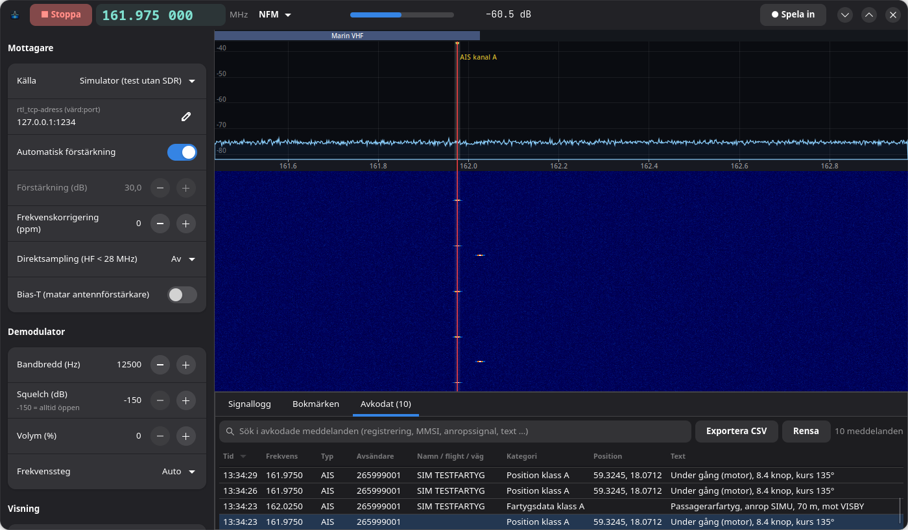
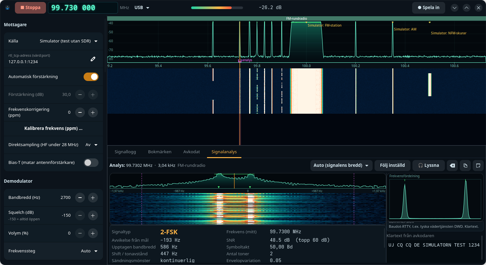
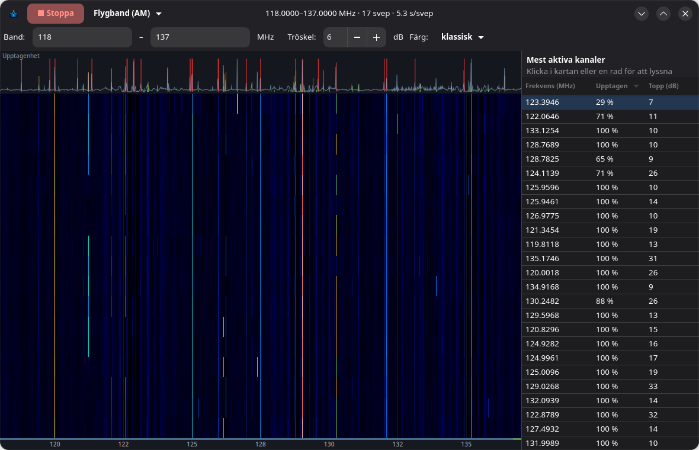
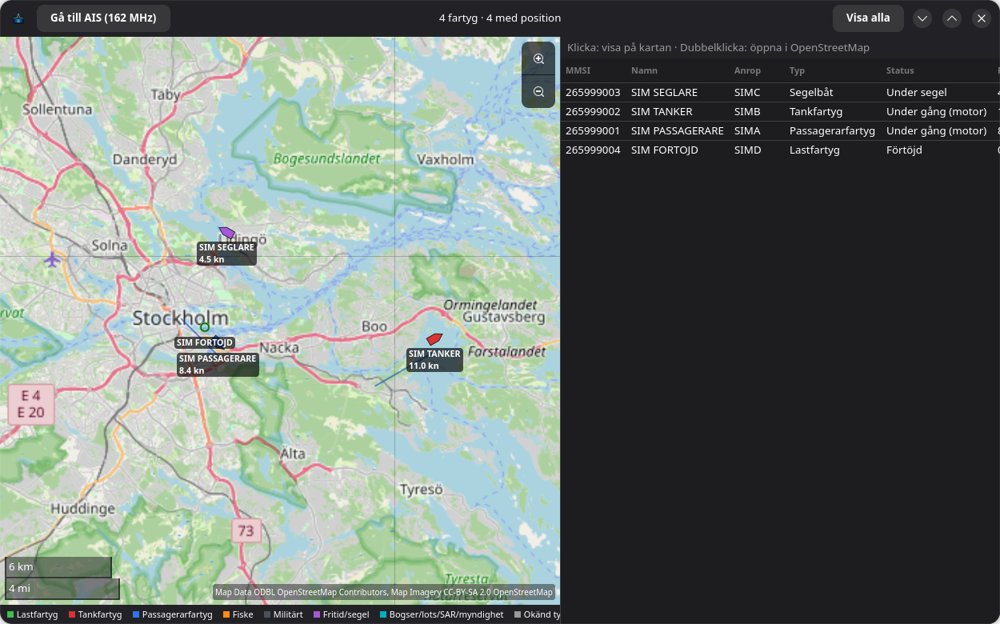
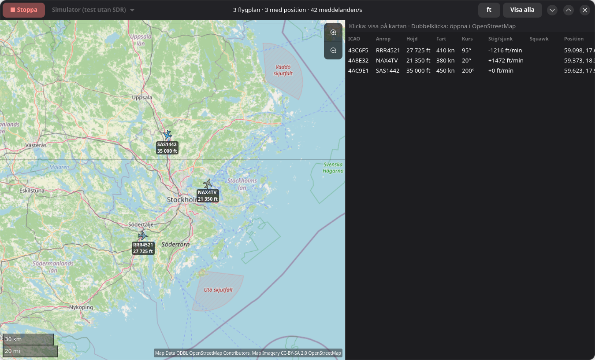
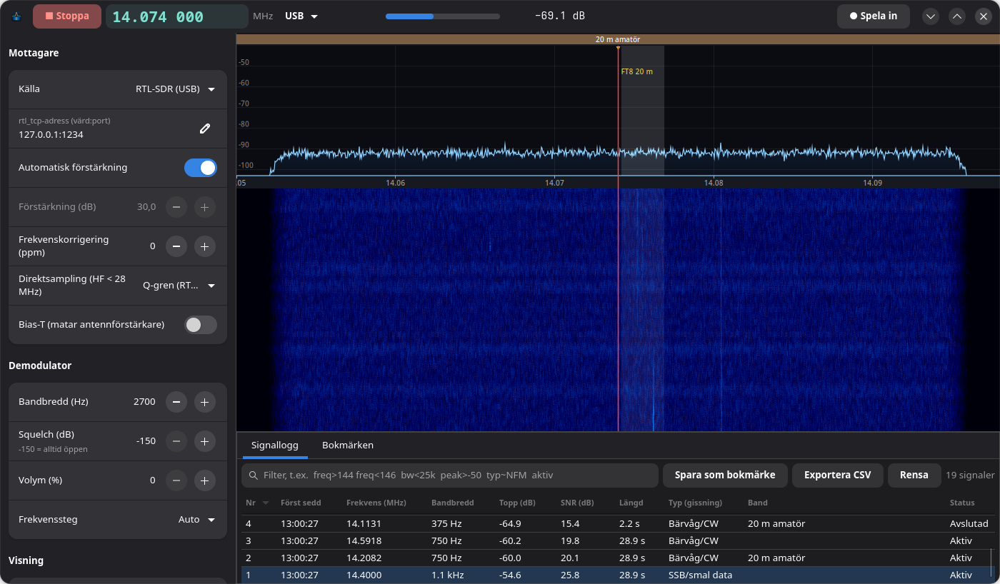
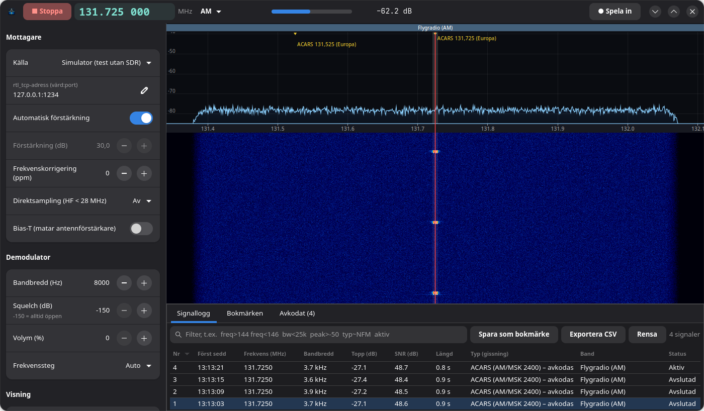
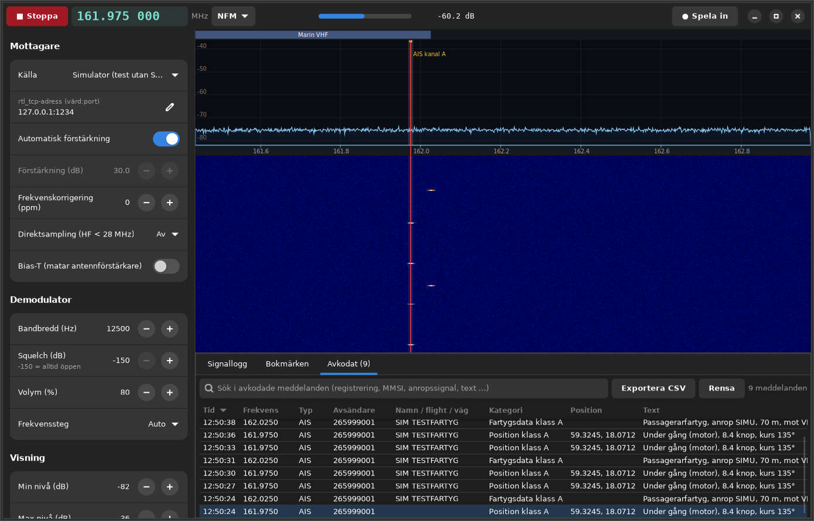

# Radiospanaren beta v2

**SDR-mottagare, radioskanner, signallogg, avkodare (ACARS, AIS, ADS-B, APRS) och spektrumanalys för Linux – på svenska.**

Radiospanaren gör en billig RTL-SDR-dongel till en komplett mottagarstation med grafiskt gränssnitt. Programmet kombinerar idéer från SDR++ (spektrum, vattenfall, demodulering), WaveShark (automatisk signallogg med filter) och KiwiSDR (bandplan, HF, webbmottagare) med en riktig radioskanner och avkodare för ACARS, AIS och APRS.

> **Beta v2:** Programmet fungerar och är testat, men det är tidig programvara. Den här versionen samlar allt: mottagare och skanner, signallogg, avkodare för ACARS, AIS och APRS, **Flygradar (ADS-B med karta)**, **fartygskarta (AIS)** och **aktivitetskarta (spektrumanalys)**. Se [Status och kända begränsningar](#status-och-kända-begränsningar).



## Funktioner

**Mottagare**
- Spektrum och vattenfall i realtid. Klicka för att ställa in, mushjul för att stega, Ctrl + mushjul för att zooma.
- Zoom-FFT: när du zoomar räknas spektrumet om med finare upplösning (ner till cirka 12 Hz), så att FT8, CW och SSB syns.
- Demodulering: WFM, NFM, AM, USB, LSB och CW. Squelch, AGC och de-emfas.
- HF (0,5–28,8 MHz) via direktsampling (Q-grenen).
- Källor: RTL-SDR via USB, rtl_tcp (en dongel på en annan dator) och en inbyggd simulator för test utan hårdvara.
- Bandplan i vattenfallet: rundradio, amatörband, flyg, marin VHF, PMR446, militärflyg UHF, Rakel/TETRA och mer.

**Skanner**
- Skannar bokmärken eller ett frekvensintervall. Hela fönster på cirka 1,2 MHz analyseras samtidigt, så skanningen går snabbt.
- Stannar bara på riktiga signaler. Grannkanaler till starka sändare räknas inte som egna signaler.
- Hoppar automatiskt över omodulerade bärvågor, alltså störningar från dongeln eller datorn. Den mäter om ljudet varierar som tal.
- Spärrlista ("Hoppa över"), väntetid och max lyssningstid.

**Signallogg** (som WaveShark)
- Hittar alla signaler över brusnivån i hela fönstret och loggar frekvens, bandbredd, nivå, SNR och längd.
- Känner igen signaltyper på frekvensen: ACARS, VDL2, AIS, APRS, ADS-B, nödfrekvenserna 121,5 och 243,0 MHz, PMR446, FT8, vädersatelliter, UVB-76 och dongelns kristallövertoner.
- Filter i stil med Wireshark: `freq>144 freq<146 bw<25k peak>-50 typ~NFM aktiv`. Export till CSV.

**Signalanalys** (ny i 2.2, fler avkodare i 2.3)
- Klicka på en bärvåg i vattenfallet, så visas den i fliken *Signalanalys* (eller i ett eget fönster). Där finns ett litet vattenfall som täcker kanalen och en ruta med mätvärdena: signaltyp, mittfrekvens, SNR, bandbredd, symboltakt, shift, antal toner, deviation, modulationsgrad, CTCSS och en bedömning av trafiken.
- Modulationsigenkänning: bärvåg, CW/OOK, AM, FM, SSB, 2/4-FSK, MFSK, MSK, BPSK, QPSK, 8PSK, linjär PSK/QAM och parallelltonmodem/OFDM. Diagrammet byter efter typ: konstellation, frekvensfördelning, envelop eller tonspektrum.
- Jämför med en signaldatabas (`signaldb.py`, egna tillägg i `~/.config/radiospanaren/signaler.json`), även militära datavågformer: STANAG 4285/4529/4539, MIL-STD-188-110, Link 11 CLEW/SLEW, ALE (MIL-STD-188-141), ANDVT, marinens FSK-sändningar. Igenkänningen gäller vågformen. Krypterad trafik kan identifieras men inte läsas.
- Avkodar direkt i analysen: RTTY (Baudot), Morse, **NAVTEX/SITOR-B**, **POCSAG**, **ALE 2G (MIL-STD-188-141)**, **väderfax** (bilden visas och kan sparas som PNG) och **DMR-identifiering** (färgkod, grupp/ID, krypterat eller inte). Avkodaren väljs automatiskt eller tvingas fram. Hela meddelanden hamnar även i fliken Avkodat. Nya avkodare läggs till i `analysavkodare.py`.



**Utseende**
- Nytt standardutseende, *Spanare*: mörk marin med bärnstensfärgade detaljer och en ny färgskala för vattenfallet. *Klassisk* finns kvar.

**Avkodare** (egna implementationer, ingen extra programvara behövs)
| Avkodare | Signal | Visar |
|---|---|---|
| **ACARS** | AM/MSK 2400 bit/s, 129–137 MHz | Registrering, flight, label, meddelandetext |
| **AIS** | GMSK 9600 bit/s, 161,975 och 162,025 MHz | MMSI, namn, anropssignal, fartygstyp (även militärt), position, fart, kurs, destination |
| **APRS** | AFSK 1200 bit/s, 144,800 MHz | Anropssignal, väg, position (även komprimerad och Mic-E), status, meddelanden |
| **ADS-B** | PPM 1 Mbit/s, 1090 MHz (eget program: **Flygradar**) | Flygplan på karta: anrop, höjd, fart, kurs, stig/sjunk, squawk |

Bara meddelanden med korrekt kontrollsumma (CRC) visas. Positioner kan öppnas på OpenStreetMap.

**Aktivitetskarta (värmekarta)**
- Sveper ett valt band om och om igen och ritar en värmekarta över tid med signalnivå per kanal, plus en upptagenhetsremsa och en lista över de mest aktiva kanalerna.
- Färdiga band eller eget intervall, valbar tröskel och färgskala. Klicka för att lyssna. WFM-rundradion 96–108 MHz utesluts.



**Fartygskarta (AIS)**
- Visar fartygen som AIS-avkodaren hört på en OpenStreetMap-karta, med kursriktning, färg efter fartygstyp (även militära fartyg) och spår.
- Tabell med MMSI, namn, anrop, typ, status, fart, kurs, position och destination. Varnar för AIS-nödsändare.



**Flygradar** (eget program, startas från Radiospanaren eller med `flygradar`)
- Visar flygplanen i närheten på en OpenStreetMap-karta (libshumate), med kursriktning, höjdfärg och spår.
- Avkodar Mode S och ADS-B: DF17/18, DF11 och DF4/5/20/21. CRC-24 med rättning av enstaka bitfel, och CPR-positionsavkodning (global och lokal).
- Varnar för nödkoderna 7500, 7600 och 7700. Saknas kartan kan den installeras med en knapp.



**Övrigt**
- Ljudinspelning (WAV) och automatisk inspelning när squelch öppnar.
- IQ-inspelning av hela bandet (1,5 MHz) som SigMF (cu8/cf32) eller WAV (SDR++/SDR#-format). Omstämningar under inspelningen sparas.
- Uppspelning av IQ-filer som mottagarkälla: SigMF, WAV, rtl_sdr `.cu8`, `.cs8`, `.cs16`, `.cf32`/`.cfile` och gqrx. Paus, spolning, 1–8× eller maxfart, slinga. Andra samplingstakter räknas om automatiskt. Allt fungerar på filen: avkodare, signalanalys, skanner och signallogg.
- Webbgränssnitt (KiwiSDR-liknande): vattenfall, inställning och ljud i webbläsaren på `http://127.0.0.1:8073/`.
- Loggfil och knappen "Kopiera felrapport" (eller `radiospanaren --rapport`), som ger en rapport att klistra in när du ber om hjälp.
- Fullständig kommandorad för start, skanning, avkodning, självtest och felsökning.

## Krav

- Linux med **GTK 4.12+ och libadwaita 1.5+**: Fedora 40+, Ubuntu 24.04+, Linux Mint 22+ eller Debian 13+. Ubuntu 22.04 och Mint 21 är för gamla.
- Python 3 med PyGObject, pycairo, numpy och scipy (installeras av skriptet).
- En RTL-SDR-dongel (RTL2832U). Utan dongel fungerar simulatorn.

## Installation

```bash
git clone https://github.com/EriHil/radiospanaren-beta-v2.git
cd radiospanaren-beta-v2
./installera.sh
```

Skriptet gör följande:
- installerar saknade paket med `apt` eller `dnf` (frågar först)
- kontrollerar versionerna
- kopierar programmet till `~/.local/share/radiospanaren`
- skapar genvägar i programmenyn och på skrivbordet
- kontrollerar att DVB-drivrutinen är blockerad och att du har åtkomst till dongeln
- kör ett självtest

Avinstallera med `./installera.sh --avinstallera`.

### Flatpak (alla distributioner)

För distributioner där systemets GTK är för gammalt (t.ex. äldre Ubuntu/Debian/Mint)
finns ett Flatpak-paket som tar med egna bibliotek. Se [flatpak/README.md](flatpak/README.md):

```bash
flatpak install flathub org.flatpak.Builder org.gnome.Platform//51 org.gnome.Sdk//51
flatpak run org.flatpak.Builder --user --install --force-clean build-dir flatpak/se.eh.Radiospanaren.yaml
flatpak run se.eh.Radiospanaren
```

## Kom igång

```bash
radiospanaren                                          # starta
radiospanaren --simulator --start                      # prova utan dongel
radiospanaren --frekvens 161.975 --mod NFM --ais --start --flik avkodat      # fartyg (AIS)
radiospanaren --frekvens 131.725 --mod AM --acars --start                    # flygplan (ACARS)
radiospanaren --mod AM --skanna intervall --intervall 118-137 --kanalsteg 25 --squelch -15
radiospanaren --direktsampling q --frekvens 14.074 --mod USB --start         # HF, FT8 på 20 m
flygradar --start                                      # flygplan på karta (ADS-B)
radiospanaren --frekvens 161.975 --mod NFM --ais --start --fartygskarta   # fartyg på karta (AIS)
radiospanaren --aktivitetskarta                        # värmekarta över ett band
radiospanaren --sjalvtest                              # testa signalbehandling och avkodare
radiospanaren --manual                                 # hela manualen
```

Hela manualen, med alla kommandon, filtersyntax, mus och tangenter, filer och vanliga problem, finns i [MANUAL.txt](MANUAL.txt).

## Skärmbilder

| HF: FT8 på 20 m med zoom-FFT | ACARS i signalloggen (simulator) | Ubuntu 24.04 |
|---|---|---|
|  |  |  |

## Status och kända begränsningar

Testat på Fedora 45 (KDE) med en Nooelec NESDR SMArt v5 (R820T) och i rena Ubuntu 24.04- och Debian 13-miljöer (samma bas som Linux Mint 22 respektive Debian stable). Flatpak-paketet är byggt och verifierat (karta, avkodare och självtest).

| Del | Status |
|---|---|
| Spektrum, vattenfall, demodulering | Testat med riktiga signaler (VHF/UHF och HF) |
| Skanner (bokmärken, intervall, störningsfilter) | Testat med riktiga signaler |
| AIS-avkodare och fartygskarta | **Verifierad med riktiga fartyg.** Paket över cirka 9 dB SNR avkodas. Kartan är testad på Fedora 45 och Ubuntu 24.04. |
| Aktivitetskarta | **Testad med riktiga signaler** (flygbandet). Sveper ett band och visar aktivitet per kanal över tid. |
| ACARS-avkodare | Testad med syntetiska signaler enligt standarden. Ingen riktig trafik har kunnat tas emot ännu. |
| APRS-avkodare | Testad med syntetiska signaler (klarar 7 dB SNR). Ingen riktig trafik har kunnat tas emot ännu. |
| ADS-B / Flygradar | **Verifierad med riktiga flygplan** (inomhusantenn, Stockholmsområdet). Karta testad på Fedora 45 (libshumate 1.7) och Ubuntu 24.04 (1.2). |
| Webbgränssnitt | Testat lokalt |

- Mottagarfönstret är cirka 1,2 MHz brett, så avkodarna fungerar för ett band i taget.
- Krypterad trafik, till exempel Rakel/TETRA och det mesta militära, kan inte avkodas och ska inte göra det.
- Webbgränssnittet har ingen inloggning. Slå bara på "Tillåt andra datorer i nätverket" i ett nätverk du litar på.
- En bra antenn, helst utomhus och högt upp, gör större skillnad än något annat.

## Felrapporter

Kör `radiospanaren --rapport` eller tryck **Felsökning → Kopiera felrapport** i programmet. Rapporten innehåller systeminformation och de senaste loggraderna. Klistra in den i en [issue](https://github.com/EriHil/radiospanaren-beta-v2/issues).

## Licens

Copyright © 2026 erihil. Radiospanaren är fri programvara under **GNU General Public License v3.0 eller senare**, se [LICENSE](LICENSE).

Programmet är skrivet med hjälp av [Claude Code](https://claude.com/claude-code).
